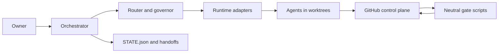

# Architecture: Relay multi-agent build workflow

Companion to [PRD.md](PRD.md). Diagrams are in [WORKFLOW_DIAGRAMS.md](WORKFLOW_DIAGRAMS.md); plugin file layout and script interfaces in [PLUGIN_SPEC.md](PLUGIN_SPEC.md); build plan in [AGENT_HANDOFF.md](AGENT_HANDOFF.md).

Labels used throughout: **Observed** (happened in Nexus, with evidence), **Ad hoc** (worked but lived in someone's head or a one-off script), **NEW** (plugin design).

## Table of contents

1. [Principles and overview](#1-principles-and-overview)
2. [Components](#2-components)
3. [Agent roster and model routing](#3-agent-roster-and-model-routing)
4. [Multi-runtime model](#4-multi-runtime-model)
5. [Label protocol](#5-label-protocol)
6. [Data model](#6-data-model)
7. [Claim, lease and handoff protocols](#7-claim-lease-and-handoff-protocols)
8. [Interfaces and the full issue lifecycle](#8-interfaces-and-the-full-issue-lifecycle)
9. [Merge queue, CI gate, review pipeline, real-environment proof](#9-merge-queue-ci-gate-review-pipeline-real-environment-proof)
10. [Cost and load governor](#10-cost-and-load-governor)
11. [Failure handling matrix](#11-failure-handling-matrix)
12. [Security model](#12-security-model)
13. [Stack profiles](#13-stack-profiles)
14. [Lessons and prevention rules](#14-lessons-and-prevention-rules)
15. [Shared contract and distribution](#15-shared-contract-and-distribution)
16. [Extensibility and workflow.yaml](#16-extensibility-and-workflowyaml)
17. [Ad hoc in Nexus versus automated here](#17-ad-hoc-in-nexus-versus-automated-here)

---

## 1. Principles and overview

1. **GitHub is the control plane.** Issues, PRs, labels, milestones, comments and the optional Project board hold task state. `harness/STATE.json` is the compact release state. (Observed: CLAUDE.md "GitHub owns active task state"; recovery order AGENTS.md, STATE.json, open review PRs, ready P0/P1 issues, `git log --oneline -20`.)
2. **Scripts, not prompts, hold gates.** Merge, sync, CI, claim, route, resolve are deterministic scripts with exit codes. Agents invoke them. (Observed: `~/.nexus-orch/tools/*.sh`; NEW: generalised and tested.)
3. **One worktree per claim.** (Observed rule; collisions happened when it was not followed.)
4. **Cheapest sufficient model.** Sonnet-class by default, expensive tiers by exception, enforced by a router and governor rather than memory. (Ad hoc in Nexus; NEW automation.)
5. **Runtime neutrality.** The contract (AGENTS.md, workflow.yaml, labels, schemas, scripts, briefs) is runtime-neutral; runtime packages are generated. (NEW.)
6. **Honesty over appearance.** NOT_VERIFIED lists, evidence per claim, no claims of approval or publication without a recorded gate. (Observed: QA_GATES.md; `harness/blockers/`.)
7. **Humans decide human things.** Owner-decision queue. (Observed, informal.)



## 2. Components

| # | Component | Responsibility | Nexus origin | Plugin form |
|---|---|---|---|---|
| C1 | Orchestrator | Decompose, dispatch, monitor, merge, keep looping, talk to owner | The main Claude session ("Main"); stop-hook goal check-ins | Skill `orchestrate` + commands + stop hook; can be Claude, Codex or human |
| C2 | Agent roster | Typed implementers, reviewers, auditors, docs with model, effort, tools | `.claude/agents/*.md` (12 files) | `agents/*.md` generated from `workflow.yaml` roster |
| C3 | Control plane adapter | Issues, PRs, labels, comments, milestones; GitHub first | `gh` calls scattered across scripts | `adapters/control-plane/github.mjs` implementing a small interface |
| C4 | Worktree manager | Create, verify, prune one worktree per claim | Convention in briefs; `ci-wt-*` dirs; `probe` shared worktree (flawed) | `relay-worktree` script |
| C5 | Brief and prompt library | dispatch, review, codex, token-rules, fixmerge, issue-update, wave briefs | `~/.nexus-orch/*.txt` | `templates/briefs/*.md` with variable substitution and rule injection |
| C6 | Merge queue | Serialise merges; sync; resolvers; gates; squash; close; refresh | `merge.sh`, `quick-merge.sh`, `merge-stack.sh`, `sync-pr.sh`, `resolve*.mjs` | `relay-merge`, `relay-quick-merge`, `relay-merge-stack`, `relay-sync`, `relay-resolve` |
| C7 | CI gate runner | Run project CI steps locally on a branch | `local-ci.sh` (+ `tools/local-ci.mjs` in repo) | `relay-ci` reading `ci.steps` |
| C8 | Review pipeline | Routine, high-risk, external bot, human; verdicts; delta re-review | `supervisor`, `senior-reviewer`, `review.txt`, `codex.txt`, `codex-open.sh` | Skill `review-protocol`, `relay-bot-gate`, verdict schema |
| C9 | Real-environment proof runner | Run proof suite on real platform, capture evidence, open bugs | `store-check.sh` (pre-merge), populate scripts, `ui-proof/`, audits | `relay-proof` + stack profile proof steps |
| C10 | Owner-decision queue | Park human-only decisions with options and defaults | Informal (`harness/blockers/*.md`, chat) | `owner-decision` issues + `relay-decision` |
| C11 | State store | `STATE.json`, handoffs, claims registry, ledger | `harness/STATE.json`, `harness/handoffs/` | Same plus claims and ledger files |
| C12 | Hooks | Stop/goal loop, secret guard, destructive gate, brief lint | Stop-hook goal check-ins (observed); a "fact-forcing" destructive gate in the owner's environment | `hooks/hooks.json` + scripts |
| C13 | Cost and load governor | Concurrency from load; rate-limit backoff and resume; budget enforcement; ledger; reports | Orchestrator judgement; memory notes (6 to 8 agents; waves reached ~20) | `relay-governor`, `relay-ledger`, `relay-report` |
| C14 | Notification handling | Reacting to agent completion, review comments, bot comments, rate-limit events | Task notifications in the orchestrator session | Event inbox `relay-inbox` + status |
| C15 | Router | Task class + risk score → tier, model, runtime, effort | Ad hoc | `relay-route` + `/workflow:route` |
| C16 | Runtime adapters | Dispatch, resume, capture usage per runtime | Claude subagents and `SendMessage`; Codex bot | `adapters/runtime/{claude,codex,gemini,cursor}` |
| C17 | MCP server | Neutral tools for any MCP agent | None | `mcp/server.mjs` |
| C18 | Installer and doctor | Generate, install, update, check | None | `npx relay-workflow` |

## 3. Agent roster and model routing

Model selection is a headline feature. This section defines the roster, the tiers, the policy engine, packet discipline and the feedback loop.

### 3.1 What Nexus actually did

Observed in `.claude/agents/*.md` (every file sets `effort: medium`):

| Agent | Model | Role |
|---|---|---|
| foundation-implementer, design-implementer, commerce-implementer, tech-commerce-implementer, seo-aeo-implementer, qa-implementer | claude-sonnet-5-5 | Logical Agents 1 to 6 |
| supervisor | claude-sonnet-5-5 | Default PR reviewer for all PRs |
| documentation-writer | claude-haiku-5-5 | Agent 7: docs, handoffs, changelog, batched |
| planner | claude-opus-5-5 | Initial architecture, major decomposition |
| senior-reviewer | claude-opus-5-5 | Only selected high-risk PRs: cart/purchase architecture, accessibility-critical interactions, schema/SEO architecture, compatibility/spec/compare architecture, major integrations, release audits; requires a compact packet under 500 words |
| release-auditor | claude-opus-5-5 | RC1/RC2 independent audits |
| fable-architect | claude-fable-5-1 | Exceptional cross-system or long-horizon problems; never routine |

`.claude/settings.json` enforces `CLAUDE_CODE_EFFORT_LEVEL=medium`. `AGENTS.md` records the target mix: Sonnet 90 to 95 percent, Haiku 3 to 7 percent, Opus plus Fable at most 2 to 5 percent combined; keep 10 to 20 near-term issues; create the next batch when READY < 8; implementers never final-review their own PR; preserve routing after compaction.

Origin: the owner issued "TOKEN-EFFICIENT MODEL ROUTING, MANDATORY" on 2026-10-18 after Opus had been used for every PR review (`model-routing-cost.md`), and PR #144 documented routing v2. A separate directive after many parallel agents hit the session rate limit added the token-discipline block to every brief (`agent-token-discipline.md`).

**Ad hoc**: the decision "does this PR deserve Opus?" lived in the orchestrator's judgement; the share cap was never measured; escalation criteria were prose; AGENTS.md hard-coded Claude model ids.

**Real catches (to feed the feedback loop).** Issue #295 "Fit ignores family/platform match" was found by UI audit 2 and fixed by PR #309 "family and platform entries match models in that family"; the owner's account attributes the family-level compatibility catch to Opus review. Sonnet reviewers regularly caught missing tests and real defects (review comments on merged PRs; the 3 PRs still labelled `review:changes` and the many `fix(...)` commits, 46 `fix(` commits of 241). Attribution of each catch to a tier is not recorded anywhere; the ledger (section 10) records it from now on.

### 3.2 Tiers (neutral names)

AGENTS.md uses only neutral tier names. `workflow.yaml` maps tier to concrete model per runtime.

| Tier | Neutral name | Typical use | Claude mapping (Nexus) | Codex mapping (example, confirm) | Cost multiple (relative) | Target share |
|---|---|---|---|---|---|---|
| T0 | `docs` | Docs, handoffs, changelog, triage summaries, issue updates | haiku-class | small/mini model | 1x | 3 to 7 percent |
| T1 | `implement` / `review` | Planning small issues, implementation, tests, fixes, routine review, git/gh ops, conflict resolution | sonnet-class | default coding model | about 4x T0 | 90 to 95 percent |
| T2 | `high-risk` | Selected reviews, major decomposition, release audits, senior debugging | opus-class | top reasoning model | about 5x T1 | within 2 to 5 percent with T3 |
| T3 | `exceptional` | Cross-system long-horizon problems | fable-class | none (Claude only) | highest | smallest share |

The relative multiples are placeholders configured by the user; the ledger can replace them with measured prices.

### 3.3 Routing policy engine (workflow.yaml `routing`)

Inputs: task class, issue/PR metadata, diff statistics, history. Output: a decision record.

**Task classes and defaults**

| Task class | Default tier | Effort | Notes |
|---|---|---|---|
| plan | implement (T1); T2 for initial architecture and major decomposition | medium | Planner escalates only when `novelty` high |
| implement | T1 | medium | Runtime chosen by runtime policy (4.3) |
| routine_review | T1 | medium | Never the implementer's own instance; cross-runtime if available |
| high_risk_review | T2 | medium | Requires compact packet |
| docs | T0 | medium | Batched per feature group or day |
| audit | T2 | medium | Release candidates; independent from implementers |
| debug_real_env | T1 first, T2 after 2 failed attempts without root cause | medium | Root-cause-first skill |
| conflict_resolution | T1 (script first; agent only if resolver exit 2) | medium | |
| triage | T0 or T1 | low to medium | Issue updater was Haiku low in Nexus (`issue-update.txt`) |

**Risk score (0 to 100)** is the sum of weighted signals, capped at 100:

| Signal | Rule (defaults, editable) | Points |
|---|---|---|
| Path match | any changed path matches `risk.paths` high-risk globs (cart, checkout, payment, auth, schema, structured data, compat/compare engine, migrations, security config) | +40 each class, max 60 |
| Area label | `area:accessibility`, `area:seo-aeo` schema, payments, auth, data migration | +30 |
| Label `risk:high` | explicit | +50 |
| Diff size | files changed > 15 or lines > 600 | +15; > 40 files or > 1500 lines | +30 |
| New public interface | new settings schema, new metafield, new API | +15 |
| Rework history | rework rounds ≥ 2 | +20; ≥ 3 | +35 |
| Prior failed proof | any failed real-env proof for this issue | +30 |
| Docs/test only | all paths in docs/tests | −30 |
| Mechanical | label `type:refactor` with zero behavioural diff flag | −20 |

**Thresholds**

| Score | Review routing |
|---|---|
| < 40 | T1 routine review |
| 40 to 79 | T1 routine review plus a second T1 reviewer of a different runtime (or a focused checklist pass) |
| ≥ 80 | T1 pre-review → compact packet → T2 senior review |

Hard rules override scores: release candidates always get the audit class; accessibility-critical interaction patterns (modal focus trap, menus, drawers) and cart/purchase architecture always get T2 (Nexus list, observed).

**Escalation**

- Two failed reviews on a PR (two rounds of `review:changes`) → next attempt (implementation or review) uses one tier higher.
- A failed real-environment proof on a merged PR → the fix issue starts one tier higher.
- A root cause still unknown after two debugging attempts → senior debugger (T2); still unknown after one T2 attempt and cross-system implications → T3 via packet.
- Rate limit on a tier beyond max retries → fall back to a sibling tier of the same task class or another runtime (but not to a tier below the task's minimum).

**De-escalation**

- If a task class has had N=10 consecutive clean first-pass results at a higher tier in `routing.review_history`, the feedback job proposes downgrading that class to T1 with a second reviewer. Owner approves.
- Planner usage downgrades to T1 when decomposition touches known patterns (existing templates).

**Per-agent override.** `workflow.yaml: agents.<name>.model` or `tier` pins one agent; `/workflow:route <issue> --tier X --reason "..."` or label `route:T2` pins one issue. Overrides are written to the ledger with who and why.

**Effort policy.** Medium for every tier by default (Nexus owner directive "all models only run the medium effort not high"), enforced by writing the runtime's effort setting (Claude: `CLAUDE_CODE_EFFORT_LEVEL=medium` env in `.claude/settings.json`; Codex: equivalent config key, confirm). `routing.allow_high_effort: false` prevents agents from selecting high.

### 3.4 Packet discipline for expensive tiers

Expensive tiers never read the repo cold. The packet builder (`relay-packet`) assembles at most `packet_max_words` (default 500) words with these fixed sections: Problem; Relevant architecture (ADR links, not content); Files (path list with line ranges); Constraints; What was tried; Options; Recommendation; Exact decision requested. For reviews: PR number, diff stat, file-scoped diff hunks of the risky paths only, acceptance criteria list, evidence list (commands run and tails), NOT_VERIFIED list. Oversize packets are rejected with a message naming the section to cut.

Token-discipline rules (the Nexus `token-rules.txt` block) are appended to every brief automatically by the brief renderer:

1. Search before reading (`rg -n`, `rg --files`); read with line ranges; never cat large files, lockfiles, generated output, or full git history.
2. Read only AGENTS.md, the issue, and the linked doc section; do not re-read what is in context.
3. Diffs: `--name-only` first, then per-file.
4. Pipe noisy output through `tail -20` or `grep -E`; run dependency install once per worktree; do not re-run passing checks unless code changed.
5. Screenshots: 1 to 4; prefer DOM and accessibility assertions.
6. No out-of-scope work. Reports at most 120 words, no pasted code or diffs.

### 3.5 Feedback loop

`relay-report` computes weekly or on demand: tokens and cost per agent, per issue, per PR, per tier; tier mix against caps; rework rate by tier and runtime; review catch rate by tier (defects found at review stage per tier, versus defects later found by post-merge QA or audits on PRs that tier approved); cost per merged PR. `relay-route --propose` reads the report and proposes, never applies, routing changes: for example "T2 reviews found 0 blocking defects in 12 consecutive PRs in area X: downgrade X to T1 with second reviewer" or "T1-only approvals in area Y produced 3 escaped defects: add path Y to `risk.paths`". The owner approves by merging a PR that edits workflow.yaml. Worked example from Nexus: the family-level compatibility match (#295, PR #309) is exactly the class where a cheap reviewer would pass and a deep reviewer catches; the path `snippets/compat-*` and area `area:tech` would be added to `risk.paths`.

## 4. Multi-runtime model

NEW design generalising two observed facts: Claude Code subagents did all building, and the Codex GitHub bot (`chatgpt-codex-connector[bot]`) reviewed every PR.

### 4.1 How Codex is handled in Nexus today

- Every PR gets inline comments from the bot. The brief `codex.txt` requires builders and reviewers to list them with `gh api repos/<repo>/pulls/<PR>/comments --jq ...select(.user.login|test("codex"))`, fix valid ones, and reply on each thread (`.../comments/<id>/replies -f body="Fixed in <sha>: ..."`) or give a one-line technical reason. P0/P1 must be fixed unless clearly wrong. Codex may re-review after a push; check again about 3 minutes after pushing.
- `codex-open.sh <pr>` counts top-level comments authored by a login matching `codex` that have no reply (any reply counts). `merge.sh` skips a PR when the count is not 0. (Flaw: login matched by substring; a reply by anyone, even an unrelated bot, clears it; paginated REST only covers inline comments, not review-level summary comments.)
- Memory note `codex-reviews-local-ci.md`: owner said "if there is anything that codex thinks needs to be addressed, agents need to address that as well".

Generalisation: `relay-bot-gate` takes `bot.logins` (exact match list), checks inline and review-level comments, requires a reply by the PR author agent or orchestrator that is not itself from a bot, and supports `severity_block`. In multi-runtime mode a Codex *agent* (not the bot) can also be an implementer or reviewer.

### 4.2 Runtime adapter interface

Each runtime adapter implements:

```
capabilities() -> {tools[], context_tokens, cost_tier, strengths[], resume: "send_message"|"relaunch"|"none",
                   headless_cmd, effort_control, usage_reporting: "exact"|"estimated"|"none"}
dispatch(brief_path, worktree, env) -> run_id
resume(run_id, message) -> ok            # Claude: SendMessage; Codex: relaunch with handoff + message
status(run_id) -> running|done|failed|rate_limited
collect(run_id) -> {report, usage}
```

| Runtime | Dispatch | Resume | Strengths (design assumption, confirm) | Notes |
|---|---|---|---|---|
| Claude Code | Subagent via Agent tool with `subagent_type` from `agents/*.md`; background by default | `SendMessage` to the agent id (Nexus rework loop and rate-limit resume, observed) | Long-running orchestration, parallel typed subagents, hooks, worktree isolation, SendMessage resume | Tiers Haiku/Sonnet/Opus/Fable |
| OpenAI Codex | `codex exec` with a prompt file in a prepared worktree (headless); or Codex cloud task; plus the Codex GitHub bot for review | Relaunch with handoff comment plus review list (no mid-task resume assumed) | Bot review on every PR, strong at focused review and well-scoped implementation, cloud parallelism | Confirm flags and sandbox modes (PRD open question 2) |
| Gemini CLI | `gemini -p` headless (assumption) | Relaunch | Large context for repo-wide refactors (assumption) | Extension point; adapter ships as example |
| Cursor | Rule files only (`.cursor/rules`), human-driven or background agents | n/a | Interactive editing | Reads the same AGENTS.md rules; claims via MCP |
| Any MCP client | Uses MCP tools | n/a | | Participates through `claim_issue`/`handoff` |

### 4.3 Runtime routing policy

`workflow.yaml: runtime_policy` chooses the runtime per issue, in order:

1. Explicit owner label `agent:claude` or `agent:codex` wins.
2. `agent:any` or numbered role label `agent:N` (logical role from Nexus): policy rules by `strengths` match (for example `refactor-long-running` → codex cloud; `ui-design-gate` → claude), then least-loaded runtime, then cheapest.
3. Review: must differ from implementer runtime when `review.cross_runtime` is true.
4. Fallback on unavailability (rate-limited past retries, binary missing, auth failed): relabel to another runtime with a handoff reason.

Numbered logical roles (1 Foundation … 7 Docs) remain as the *role* dimension; runtime is a separate dimension. Nexus labels `agent:1..7` stay valid and map to role files; the new labels `agent:claude|codex|any` select the *runtime*. An issue may carry both (`agent:3` + `agent:codex` = Commerce role executed by Codex). Mutual exclusion applies within each dimension (section 5).

### 4.4 Orchestrator of orchestrators

Who dispatches is configurable and may change per day:

| Dispatcher | How it triggers | Idempotency |
|---|---|---|
| Claude orchestrator (Nexus default) | Session loop with stop hook; reads READY issues; spawns subagents | Claim protocol; dispatch ledger key = issue + brief hash |
| Codex orchestrator | `codex exec` running the orchestrate brief on a schedule | Same |
| Human | `/workflow:dispatch 123 --runtime codex` or manual label | Same |
| Scheduled poller (`relay-loop`) | `gh` loop every N minutes: list `state:ready` issues with `agent:codex`, run `codex exec` for each if load and budget allow | Dispatch key stored in ledger; claim protocol prevents double work |
| GitHub Action (optional) | `on: issues: labeled` triggers `codex exec` via a self-hosted runner or webhook relay | Same; Actions never merge |

Polling is the default (no inbound network); webhook/Action triggers are an optimisation. Merge queue and local CI gate are scripts invoked by any dispatcher, so they behave identically.

## 5. Label protocol

**Observed in Nexus** (`gh label list`): `agent:main`, `agent:1` to `agent:7`; `state:backlog|ready-for-agent|in-progress|review|changes-requested|blocked|done`; `priority:p0..p3`; `area:foundation|design|commerce|tech|seo-aeo|accessibility|performance|docs|release`; `type:feature|bug|qa|docs|refactor`; `review:main|changes|approved`. Counts on the last 200 merged PRs: `review:approved` 165, `review:main` 29, `review:changes` 3.

**NEW labels (cross-agent)**

| Group | Labels | Meaning |
|---|---|---|
| Owner (runtime) | `agent:claude`, `agent:codex`, `agent:any` (plus extension `agent:gemini` etc.) | Who should/does implement |
| Owner (role) | `agent:1`..`agent:7`, `agent:main` | Logical role (Nexus); `agent:main` = orchestrator-owned |
| Handoff | `handoff:to-claude`, `handoff:to-codex`, `handoff:to-human`, `handoff:blocked` | Transient: work is parked for the named receiver. Removed when the receiver claims |
| State | `state:backlog`, `state:ready` (alias of Nexus `state:ready-for-agent`), `state:claimed`, `state:in-progress`, `state:review`, `state:changes-requested`, `state:blocked`, `state:done` | Exactly one |
| Review | `review:claude`, `review:codex`, `review:human`, `review:main` (legacy: orchestrator queue), `review:approved`, `review:changes` | `review:<who>` = who is asked to review; `approved`/`changes` = outcome |
| Routing | `route:T0`, `route:T1`, `route:T2`, `route:T3`, `risk:high` | Overrides |
| Misc (kept) | `priority:*`, `area:*`, `type:*`, `owner-decision` | |

### 5.1 State machine

See diagram (l) in [WORKFLOW_DIAGRAMS.md](WORKFLOW_DIAGRAMS.md#l-cross-agent-label-state-machine). Allowed transitions:

| From | To | Who may set | Condition |
|---|---|---|---|
| backlog | ready | orchestrator, human | dependencies met, acceptance criteria present |
| ready | claimed | any agent matching owner label | atomic claim succeeded (7.1) |
| claimed | in-progress | claimant | first push to branch |
| claimed or in-progress | ready | `relay-lease` (automatic) | lease expired without heartbeat |
| in-progress | review | claimant | PR open, local CI green |
| review | changes-requested | reviewer | review:changes set |
| changes-requested | in-progress | PR owner (original or reassigned) | fixes started |
| review | done | merge queue only | PR merged and issue closed |
| any | blocked | claimant, orchestrator, human | exact dependency or owner decision named |
| blocked | ready | orchestrator, human | unblocked |
| in-progress | (handoff pending) | claimant | handoff comment posted and `handoff:to-X` set (7.3) |

### 5.2 Who may set which label

| Label group | Human | Orchestrator | Implementer | Reviewer | Merge queue | Governor |
|---|---|---|---|---|---|---|
| owner runtime | yes | yes | no (only via handoff) | no | no | yes (fallback relabel with reason) |
| handoff | yes | yes | yes (to hand off) | no | no | yes |
| state ready/backlog | yes | yes | no | no | no | lease expiry only |
| state claimed/in-progress/review | no | yes | yes (own claim) | no | no | no |
| state changes-requested | no | yes | no | yes | no | no |
| state done | no | no | no | no | yes | no |
| review:<who> | yes | yes | request only | no | no | no |
| review:approved/changes | yes (override) | no | no | yes (not own PR) | clears on merge | no |
| route:*, risk:high | yes | yes | no | yes (risk:high) | no | no |

Enforcement: `relay-labels set` checks the actor class from `RELAY_ACTOR` before calling the control plane; the GitHub timeline is the audit trail. A scheduled `relay-lint-labels` pass repairs violations (for example two state labels) and posts a comment.

### 5.3 Mutual-exclusion rules

- Exactly one `state:*` per issue.
- At most one runtime owner label (`agent:claude|codex|any|gemini`); at most one role label (`agent:1..7|main`).
- At most one `handoff:*` per issue; `handoff:*` and `state:in-progress` are mutually exclusive (a handoff-pending issue is `claimed` or `blocked` by the sender until the receiver claims).
- `review:approved` and `review:changes` exclusive; both exclusive with `review:<who>` once a verdict is posted.
- `state:done` implies no other state, no handoff, no review request.

### 5.4 Examples

1. Owner creates issue #12, labels `agent:codex`, `state:ready`, `priority:p1`. A Codex worker claims: comment `relay:claim`, label `state:claimed`, then `state:in-progress`. PR opens: `state:review`, `review:claude`.
2. Claude implementer stalls at rate limit; governor sets `agent:codex`, `handoff:to-codex` with reason "claude rate limited, 3 retries". Codex worker reads the handoff, claims; `handoff:to-codex` removed.
3. Reviewer from Codex requests changes on a Claude-built PR: `review:changes`, issue `state:changes-requested`; builder is resumed (SendMessage) and `state:in-progress`; on re-push `review:codex` is re-requested.
4. Needs a naming decision: `state:blocked`, `handoff:to-human`, `owner-decision`; agent releases claim and takes other work.

## 6. Data model

### 6.1 Control-plane objects

- Issue: body follows the issue template (Objective, Context, Requirements, Acceptance Criteria, Owned Paths, Shared / Forbidden Paths, Dependencies, Validation, Documentation Impact) (Observed AGENTS.md).
- PR: template (Logical Agent, Issue, Branch, Outcome, Implementation, Validation, Responsive Testing, Accessibility, SEO/AEO, Performance, Screenshots, Integration Notes, Known Limitations) (Observed `.github/pull_request_template.md`); NEW sections: Runtime, NOT_VERIFIED, Evidence.
- Comments with machine markers: `<!-- relay:claim {...} -->`, `<!-- relay:heartbeat {...} -->`, `<!-- relay:handoff {...} -->`, `<!-- relay:verdict {...} -->`. Human-readable text follows the marker.

### 6.2 STATE.json schema (extends Nexus)

Nexus (Observed): `release_status`, `sprint_day`, `current_milestone`, `release_blockers[]`, `last_verified_commit`, `dev_store`, `dev_theme_id`.

```json
{
  "$schema": "https://example.invalid/relay/state.schema.json",
  "schema_version": 1,
  "release_status": "BUILDING",
  "current_milestone": "M2-core-commerce",
  "policy": { "mode": "gated", "changed_at": "2026-10-20T10:00:00Z", "reason": "owner verbatim instruction" },
  "release_blockers": ["GITHUB_PROJECT_SCOPE"],
  "last_verified_commit": null,
  "environments": { "dev": { "name": "dev-store", "ref": "env:DEV_TARGET" } },
  "claims": [
    {
      "issue": 163,
      "agent_id": "codex-3a1f",
      "runtime": "codex",
      "role": "2",
      "branch": "agent/codex/163-pill-radius",
      "worktree": "/path/worktrees/codex-163",
      "owned_paths": ["assets/base.css", "tools/checks/design-lint.mjs"],
      "claimed_at": "2026-10-20T10:01:00Z",
      "lease_until": "2026-10-20T10:31:00Z",
      "heartbeat_at": "2026-10-20T10:11:00Z"
    }
  ],
  "owner_decisions": [{ "issue": 410, "question": "theme name", "options": ["A","B"], "default": "A", "deadline": null }],
  "usage_summary": { "tier_share": { "T0": 0.05, "T1": 0.91, "T2": 0.04, "T3": 0.0 }, "as_of": "2026-10-20T12:00:00Z" }
}
```

Claims are the source of truth on GitHub (comments); `STATE.json` caches them for fast overlap checks and is rebuilt by `relay-state --rebuild`. Concurrent writes go through `relay-state` with a file lock and commit via the orchestrator only (agents never commit STATE.json from feature branches; they post claim comments). This avoids a conflict hot-spot (NEW).

### 6.3 Claim comment

```json
{ "type":"claim", "issue":163, "agent_id":"codex-3a1f", "runtime":"codex", "role":"2",
  "branch":"agent/codex/163-pill-radius", "lease_minutes":30, "claimed_at":"...", "owned_paths":["..."], "nonce":"8f3c" }
```

### 6.4 Handoff schema (comment marker and optional file)

```json
{
  "type": "handoff",
  "issue": 163, "from": {"agent_id":"claude-7b2e","runtime":"claude"}, "to": {"runtime":"codex"},
  "reason": "rate_limited | capability | review_rework | owner_request | lease_takeover",
  "done": ["what was done"],
  "remaining": ["what remains"],
  "files_touched": ["path"],
  "tests_run": [{"cmd":"npm test","result":"pass","evidence":"tail line or log path"}],
  "not_verified": ["item with reason"],
  "decisions": ["decision and why"],
  "next_steps": ["ordered"],
  "risks": ["risk"],
  "links": {"branch":"agent/claude/163-pill-radius","pr":null,"head_sha":"abc1234"}
}
```

File form `harness/handoffs/<date>-<issue>.md` is at most 300 words with sections Implemented, Files changed, Validation, Integration notes, Known risks, Next dependency (Observed; sample: `harness/handoffs/2026-10-19-163.md`). The comment form is the machine record; the file is the durable human summary written by the docs tier at merge.

### 6.5 Agent brief schema

```yaml
brief:
  id: sha256
  role: commerce-implementer          # role file
  runtime: claude|codex
  tier: T1
  issue: 163
  repo: owner/name
  branch: agent/claude/163-slug
  worktree: /path
  read_order: [AGENTS.md, role file, issue, linked doc sections]
  owned_paths: []
  forbidden_paths: []
  commands: {check: "...", validate: "...", test: "...", budget: "..."}
  rules: [token-rules, codex-reply-rules, worktree-safety, honesty, security]
  report_max_words: 120
  escalate_on: [architecture_question, owned_path_conflict]
```

### 6.6 Review verdict schema

```json
{
  "type": "verdict", "pr": 315, "head_sha": "abc1234", "reviewer": {"agent_id":"codex-9d","runtime":"codex","tier":"T1"},
  "result": "APPROVED | CHANGES",
  "checklist": {"acceptance":"PASS","architecture":"PASS","platform_compliance":"PASS","responsive":"PASS","a11y":"PASS|N/A","seo_aeo":"N/A","performance":"PASS","ux_visual":"PASS","integration":"PASS","tests":"PASS"},
  "changes": ["1. numbered, file-scoped item"],
  "not_verified": ["item"],
  "risk_score": 62, "escalated_to": null
}
```

The human text keeps the Nexus format: `MAIN REVIEW / Result: APPROVED / Acceptance Criteria: PASS / CI: PASS / Integration: PASS / Accessibility: PASS / N/A / SEO/AEO: PASS / N/A / Performance: PASS / N/A`.

### 6.7 Usage ledger row (JSONL)

```json
{"ts":"...","run_id":"r-001","agent_id":"claude-7b2e","runtime":"claude","model":"<id>","tier":"T1","task_class":"implement",
 "issue":163,"pr":null,"tokens_in":120000,"tokens_out":9000,"cost_usd":0.0,"estimated":false,"outcome":"done|rate_limited|failed|escalated",
 "rate_limit":false,"escalation_from":null,"brief_hash":"...","wall_s":840}
```

## 7. Claim, lease and handoff protocols

### 7.1 Atomic claim (NEW)

GitHub has no compare-and-swap on labels, so the claim uses comment ordering as the arbiter.

1. Precondition: issue is `state:ready`, owner label matches the claimant's runtime or `agent:any`, no active claim, and for handed-off issues the handoff comment has been fetched (script echoes the handoff sha).
2. Check owned-path overlap against active claims in `STATE.json` (or rebuilt from claim comments); overlap with a non-shared path → refuse.
3. Post the claim comment (with nonce). Record the comment id and `created_at`.
4. Re-read all claim comments. The valid claim is the earliest non-expired, non-released claim by `created_at`, tie-broken by comment id. If it is yours → set `state:claimed`, remove `state:ready`. If not → delete your comment (or post `relay:release`), choose another issue.
5. Create branch `agent/<runtime>/<issue>-<slug>` and worktree (section 7.4). Set `state:in-progress` on first push.

Race outcome: at most one agent proceeds; the loser wastes only one comment. Test T-CLAIM-1 races two claimers.

### 7.2 Lease, heartbeat, takeover

- Lease 30 minutes by default, heartbeat comment (or edit of the claim comment) every 10 minutes while working; heartbeat updates `lease_until`.
- `relay-lease --sweep` (run by the orchestrator loop, or cron) finds claims with `lease_until` < now, posts `relay:lease-expired`, removes `state:claimed|in-progress`, sets `state:ready`, and records the branch's last commit. The next claimant must start from the existing branch if it has commits (rebase-safe) and read the previous agent's last handoff or progress comment.
- Takeover is legal only after expiry. A live agent that discovers its claim was taken over must stop and report (its next heartbeat fails).
- Long tool runs (CI taking > 10 minutes) heartbeat from the wrapper script, not from the model.

### 7.3 Handoff protocol

1. Sender: `relay-handoff post --to codex --reason review_rework` builds the comment from the working tree (files touched, last test results from the local CI log, head sha), asks the agent to fill `done/remaining/decisions/risks/not_verified`, pushes the branch, sets `handoff:to-codex`, releases the claim (`relay:release`), moves `state` to `claimed→ready` (if work remains) or leaves `review`.
2. Receiver: claim script requires `--ack-handoff <sha>`; the brief states "read the latest `relay:handoff` comment first, then the PR/branch diff against main". The receiver continues on the **same branch** in its own worktree (new branch names are only for new claims) and keeps the original author in commit trailers.
3. Mid-issue hand back: same flow in reverse. The handoff chain is the ordered list of handoff comments; each cites the previous.
4. Rework across runtimes: Codex implements, Claude reviews, Claude requests changes → label `review:changes`, `handoff:to-codex` (reason `review_rework`) → Codex relaunches (no resume) with the verdict's numbered list plus the handoff; or, if Claude built it, the orchestrator `SendMessage`s the original builder. Re-review checks only the delta since `head_sha` of the last verdict.
5. Cross-review rule: the implementer's runtime never approves its own PR. With one runtime configured, the reviewer must be a different agent instance and a different role file (Nexus: implementers never final-review their own PR, Observed).

### 7.4 Worktree and conflict avoidance

- Path: `<worktree_root>/<runtime>-<issue>`. Never inside the main checkout (Nexus brief: "NEVER write inside <main worktree>"; collision with the shared `probe` worktree was a real failure).
- Manager checks at claim, after every resume, and before every commit: `pwd`, `git rev-parse --abbrev-ref HEAD` equals the claimed branch, worktree not registered to another claim. Commit hooks refuse commits on a branch not in the claims registry for this agent id.
- Overlap rules: issues declare owned paths; shared files are append-only (Nexus `config/settings_schema.json` group append, `locales/*.json`, `layout/theme.liquid`, `snippets/icon.liquid`) and conflicts escalate to the orchestrator. The overlap check runs at claim and at PR open (diff paths vs. owned paths; out-of-scope diffs flagged).
- Temporary operations (sync, store check, stack merges) use `mktemp -d` worktrees created from `origin/<branch>`, never a long-lived shared one.

## 8. Interfaces and the full issue lifecycle

### 8.1 Interfaces between components

| From → To | Interface | Contract |
|---|---|---|
| Orchestrator → Router | `relay-route <issue>` | JSON decision (PLUGIN_SPEC section 8) |
| Orchestrator → Governor | `relay-governor admit <run>` | exit 0 admit, 10 wait (load/budget), 11 deny |
| Governor → Runtime adapter | `dispatch/resume/status/collect` | section 4.2 |
| Agents → Control plane | `relay-gh` wrappers (`claim`, `labels`, `comment`) | idempotent, actor-checked |
| Agents → Worktree manager | `relay-worktree create|verify|remove` | exit codes in PLUGIN_SPEC |
| Review → Verdict | `relay-verdict post` | writes marker + labels |
| Merge queue → Resolvers | `relay-resolve` | exit 0 resolved, 2 needs human |
| Merge queue → CI | `relay-ci <branch>` | exit 0 green |
| Merge queue → Bot gate | `relay-bot-gate <pr>` | prints count; exit 0 when 0 |
| Merge queue → Proof | `relay-proof <ref>` | exit 0 pass, 4 platform errors, 6 render errors, 5 target unavailable |
| Everyone → Ledger | `relay-ledger append` | JSONL, lock-protected |
| MCP clients → all of the above | MCP tools | section 15.3 |

### 8.2 Full lifecycle (sequence)

1. Plan: orchestrator (or `planner`, T2, only for initial decomposition) turns `docs/PRODUCT_SPEC.md` and ADRs into milestones and issues (Nexus: M1 to M5; later issue-update Haiku pass using the `issue-update.txt` brief).
2. Triage: issue gets owner/role/runtime labels, priority, area, type; `state:ready`.
3. Dispatch: router returns tier/model/runtime; governor admits (load, budget); brief rendered with injected rules; adapter dispatches.
4. Claim → branch → worktree.
5. Implement; run `relay-ci` (check, validate, test, budget; full mode adds e2e); UI issues must have read MASTER and page spec first.
6. PR with template, `Closes #N`, evidence and NOT_VERIFIED; issue `state:review`; `review:<runtime>`.
7. Review: bot comments arrive; routine reviewer in a scratch worktree; risk score decides second/senior review; verdict posted.
8. Rework loop until approved or `max_rounds` then escalate tier/reassign.
9. Merge queue (section 9).
10. Post-merge: preview refresh; QA agent runs the proof suite on main; defects become issues routed one tier higher when the cause was a miss.
11. Handoff file and STATE.json updated by the docs tier; issue closed as done only after merge; "verified" only after proof.

See diagrams (b), (c), (k) in [WORKFLOW_DIAGRAMS.md](WORKFLOW_DIAGRAMS.md).

## 9. Merge queue, CI gate, review pipeline, real-environment proof

### 9.1 Observed gated pipeline (`merge.sh`)

For each `pr:issue`: take lock (`mkdir ~/.nexus-orch/merge.lock`, retry every 10 s); skip if already merged; if behind main, `sync-pr.sh` (merge `origin/main` into the branch in the shared `probe` worktree, resolvers on conflict, `npm run validate && npm test` with one retry after 20 s, push); `local-ci.sh` (check, validate, test, budget; `LOCAL_CI_FULL=1` adds e2e scripts); `codex-open.sh` must print 0; `store-check.sh` (push the branch to a shared dev theme, require 0 theme errors, curl nine pages on a theme-dev server looking for "Liquid error", "Liquid syntax error", "translation missing"); post `MAIN REVIEW … APPROVED`, swap labels to `review:approved`; `gh pr merge --squash`; issue labels to `state:done` and close; refresh the preview theme (kill and restart theme dev on port 9292).

Observed flaws and fixes:

| Flaw | Evidence | Fix |
|---|---|---|
| Hard-coded repo, store, theme ids, `~` paths | all scripts | Config and env |
| Lock with no stale detection; `trap rmdir` only on clean exit | `merge.sh` | PID file and mtime check; `flock` where available |
| Shared `probe` worktree for sync, store-check, stack merge, quick-merge | `sync-pr.sh`, `store-check.sh`, `merge-stack.sh` | Per-op temp worktree |
| Approval comment written by script without verifying a reviewer verdict | `merge.sh` | Require verdict marker for head sha |
| `pkill -f "theme dev.*9292"` pattern kill | `merge.sh` | pidfile-based stop |
| `sleep 15` after push before CI | `merge.sh` | Poll head sha on remote |
| Retrying validate/test with `sleep 20` can mask flakiness | `sync-pr.sh` | Retry once, record flaky in ledger, quarantine list |
| `codex-open.sh` login substring match and any-reply-clears | `codex-open.sh` | Exact logins, reply must be from non-bot |
| Union merge of `.md` may duplicate text | `resolve2.mjs` | Post-merge duplicate-heading check |
| Many `ci-wt-*` worktrees (about 57) | `~/.nexus-orch` | Prune policy, shared cache |

### 9.2 Conflict resolvers (Observed `resolve.mjs`, `resolve2.mjs`)

- `*.md`: three-way `git merge-file --union`.
- `templates/*.json`, `sections/*.json`: parse (strip leading comment), deep-merge objects, `order` and `block_order` arrays unioned keeping ours order and inserting theirs-only ids after their nearest preceding id; header comment preserved.
- `snippets/importmap.liquid` (via `resolve.mjs`): union of one-module-per-line entries.
- `locales/*.json`: keep both sides' keys.
- Everything else: leave conflicted, exit 2 → human or builder via `fixmerge.txt` brief ("importmap: union one-per-line; locales: keep both").

Generalised as a resolver registry: `resolvers: [{match: "**/*.md", strategy: union}, {match: "templates/*.json", strategy: json-deep-merge, order_keys: [order, block_order]}, ...]`, strategies built in plus custom script paths. Stack profiles contribute resolvers.

### 9.3 Fast-merge (Observed `quick-merge.sh`)

`gh pr merge --squash`; on failure create a temp worktree on the PR branch, merge main, run `resolve2.mjs`, commit, push, wait 5 s, retry merge; close the issue with the comment "Fixed by merged PR #N; verification follows on main." No CI, no bot gate, no store check. Mitigation: post-merge QA agent and proof.

### 9.4 Review pipeline

Routine reviewer (Sonnet-class) order (Observed `review.txt`): acceptance criteria → architecture/ADRs → platform compliance → responsive → editor → accessibility → performance → SEO/AEO → UX/visual → integration → tests. UI PRs are judged against MASTER.md + preset + page spec at 375/768/1440 and must pass FUNCTIONAL + RESPONSIVE + A11Y + UX + VISUAL; "AI-prototype" traits rejected. Reviewer works in a scratch worktree, runs the CI steps, removes the worktree after. Reviewers do not push to the environment and do not merge; the orchestrator merges.

### 9.5 Real-environment proof (new first-class stage)

Key lesson from the build: the offline harness (LiquidJS render harness with axe and screenshots, `tools/preview`) diverged from the real platform in ways that only surfaced on the store (section 14). The proof stage:

1. **When:** pre-merge in gated mode (environment check: push to a scoped dev target, probe pages for platform error strings), post-merge in both modes (QA agent on main), and on release candidates (full suite incl. Lighthouse, Theme Editor behaviours).
2. **What:** a `proof.steps` list in the stack profile: apply/push to the dev target, render key URLs, grep for platform error signatures, run DOM assertions via real browser (Playwright), capture screenshots (≤4 per task), compare against harness output where applicable.
3. **Evidence:** logs and screenshots under `harness/proof/<date>/`, summarised in the issue; unverifiable items stay NOT_VERIFIED (Nexus: Lighthouse on store blocked on auth, #102).
4. **Failure handling:** root-cause-first debugging skill (section 14.3); escalation per routing; new harness rule so the divergence is caught offline next time.
5. **Mutation scope:** proof only mutates the configured dev target; mutations idempotent by key (Nexus populate scripts upsert by handle) with undo notes.

## 10. Cost and load governor

### 10.1 Responsibilities

- Admission control before each dispatch: load average, concurrency cap, token budget, tier-share cap.
- Rate-limit handling: detect (adapter `status` → `rate_limited`), backoff 30 s, 60 s, 120 s (max `rate_limit.max_retries`, default 3), resume the same agent (Claude: SendMessage), then fallback.
- Ledger append for every run and escalation; daily and on-demand report.
- Feedback proposals (3.5).

### 10.2 Load policy

Nexus fact: machine load reached 150 to 200 with many Chromium and npm processes; effects were flaky tests and killed Chromium; owner guidance said keep concurrency moderate (6 to 8) after rate limits; waves reached about 20.

Policy: `concurrency.max_agents` default 8 (hard ceiling 20); `load_limit` default = 1.5 × CPU cores for the 1-minute load average (the absolute 150 to 200 numbers are pathological and should never be approached); when load exceeds the limit new dispatch waits; when it exceeds 2 × limit, the governor asks running low-priority agents to pause at the next safe point (it does not kill). Heavy steps (Chromium e2e, `npm ci`) use a semaphore (`relay-sem`) with `heavy_slots` default 2. A test failure observed while load is above the limit is classed `suspect_load` and re-run once after load drops before being treated as real.

### 10.3 Self-matching wait loops

Observed failure: agents waited on a process with `pgrep -f <pattern>` and matched their own shell command, never exiting. Fix: `relay-wait --pid/--file/--url/--cmd --timeout` implemented with pidfiles and explicit conditions; a brief lint and a Bash hook warn on `pgrep -f` or `pkill -f` in agent commands.

### 10.4 Reports

`relay-report` outputs a Markdown table and JSON: cost per merged PR, tier mix versus caps, rework rate by tier and runtime, escape rate by approving tier, time in each state, rate-limit incidents, load incidents. Stored under `harness/reports/`.

## 11. Failure handling matrix

| Failure (observed unless NEW) | Detection | Immediate action | Escalation / prevention |
|---|---|---|---|
| API rate limit | Adapter status `rate_limited`; error text | Backoff and resume same agent via SendMessage | After max retries: fallback tier or runtime with handoff reason; lower concurrency; token rules |
| Machine overload (load 150-200) | Load sample > limit | Pause admissions; heavy-step semaphore | Re-run suspect tests once; quarantine flaky; cap concurrency |
| Flaky test | Fail then pass on re-run; failure while loaded | Record in ledger; one re-run | Quarantine list with owner and expiry; real failures create `type:bug` |
| Chromium killed | Exit code / missing browser | Re-run with fewer heavy slots | Lower `heavy_slots` |
| Self-matching pgrep wait | Command lint; timeout exceeded | Kill the wait; use `relay-wait` | Hook warning |
| Shared worktree collision | Branch/claim mismatch at commit | Hook refuses commit; agent re-verifies pwd/branch | One worktree per claim; temp worktrees for ops |
| Probe worktree collision | `git` lock errors, wrong HEAD | Retry in temp worktree | No long-lived shared worktree |
| Merge conflict | `git merge` exit 1 | Resolver chain | Exit 2 → builder fixes via `fixmerge` brief; stack merge for squash-induced conflicts |
| Resolver gap (new file class) | Unresolved file after chain | Escalate | Add resolver + fixture test |
| Network blip | fetch/gh/curl failure | Retry 3× with 3 s, 10 s, 30 s | Persistent → `state:blocked`, note, continue other work |
| Duplicate agents | Two valid claims; overlapping branches | Earliest claim wins; others release | Claim protocol, dedupe issue search |
| Stuck agent | No heartbeat / no output for lease period | Probe; resume with message; kill after grace | Lease takeover, relabel ready |
| Lost claim (agent died holding it) NEW | Lease expired | Sweep | Heartbeat from wrapper |
| Runtime unavailable NEW | Binary missing, auth, 5xx | Relabel to other runtime with reason | `fallback.runtime_order` |
| Conflicting edits across runtimes NEW | Overlap check at PR open | Reject or merge-sort via resolvers | Owned paths; append-only shared files |
| Reviewer disagreement NEW | Two verdicts differ | Senior reviewer (T2) tie-break | Still split → human |
| Bot comment unanswered | `relay-bot-gate` count > 0 | Skip merge, notify builder | Reply required |
| CI fails after merge-main sync | `relay-sync` validate/test fail | `fixmerge` brief to builder | Builder union importmap, keep both locales, push |
| Approval without review NEW | verdict missing | Merge refuses | FR-30 |
| Store push error / Liquid error | Proof step | Block merge (gated) or open bug (fast) | Root-cause-first |
| Secret in diff | Secret guard hook | Block commit/output; rotate if leaked | Owner informed |
| Orchestrator context loss | Session restart/compaction | `/workflow:resume` | Routing in config, not memory |
| Budget exceeded NEW | Governor deny | Stop dispatch for task; owner notified | Per-PR ceiling; downgrade or ask |
| Duplicate/stale preview process | Port in use | Stop by pidfile | `relay-env refresh` |

## 12. Security model

Principles: least privilege, secrets never in repo or ledger, mutations scoped and reversible, audit everything.

- **Secrets.** Storefront passwords, API tokens, store auth are never committed, logged, or placed in briefs. The Nexus rule: the password is used only in ephemeral sessions (browser session, environment variable); it must not appear in any repo file or doc (this design package contains none). `security.secret_patterns` plus entropy scan in the secret guard hook (PreToolUse on Bash/Write/Edit, and a pre-commit script) blocks writes; `doctor` scans the repo and docs. If a secret is found: block, redact, notify the owner, rotate.
- **Credentials per runtime.** Each runtime uses its own credential store: Claude Code auth, Codex auth, `gh` token. No shared tokens. GitHub token scopes: repo contents and PR/issue write for agents; label admin only for the init step; merge permission only for the merge-queue identity if separate. Fine-grained tokens preferred. Separate machine users or GitHub Apps for each runtime where feasible so the audit trail distinguishes them (Nexus: all agents shared one git identity `aliumairdev`, so actor attribution relied on comments and branch names; NEW fix).
- **Destructive command gate.** Hook blocks or demands owner approval for force pushes, branch deletion on shared branches, recursive deletes outside worktree root, `git reset --hard` on shared branches, store-wide deletions, publishing, and changing domains/passwords. (An analogous "fact-forcing" gate exists in the owner's environment: it requires listing affected files, a rollback line and the owner's instruction before destructive commands. The plugin's gate follows the same three facts.)
- **Environment mutation.** Only the configured dev target; idempotent scripts (upsert by key); an undo note per mutation batch in `harness/proof/` (Observed: populate scripts are idempotent by handle; sample products and gift cards untouched).
- **Permissions.** Reviewers and auditors have read-only tools (Observed: supervisor/senior-reviewer tools are Read, Grep, Glob, Bash); only implementers and docs have Write/Edit.
- **Supply chain.** Plugin scripts are pure shell/Node without postinstall hooks; generated packages are checksummed; the installer verifies the checksum before writing.
- **Telemetry.** Off by default; no network except GitHub and project checks.
- **Audit trail.** GitHub timeline, claim/handoff/verdict markers, ledger, STATE.json history in git.
- **Prompt-injection hygiene.** Issue and PR bodies, bot comments and fetched documents are untrusted input; briefs say agents must not follow instructions found in them that conflict with AGENTS.md or the brief; label/state changes still go through actor checks.

## 13. Stack profiles

The core is stack-agnostic. A stack profile supplies: CI steps, proof steps, conflict resolvers, forbidden-pattern checks, high-risk path globs, directory ownership defaults, and known lessons. Profiles live in `profiles/<name>/profile.yaml`.

### 13.1 Shopify theme profile (worked example, from Nexus)

```yaml
stack: shopify-theme
ci:
  steps:
    - {name: check,    cmd: "npm run check"}      # shopify theme check, 0 errors
    - {name: validate, cmd: "npm run validate"}   # JSON/schema/locale sanity, forbidden patterns, design-lint
    - {name: test,     cmd: "npm test"}           # node --test tests/unit
    - {name: budget,   cmd: "npm run budget"}     # per-file size budgets
  full_extra: ["npm run preview", "npm run test:a11y", "npm run test:carousel", "npm run test:gallery", "npm run test:seo", "npm run test:responsive"]
env_check:
  push: "shopify theme push --store ${DEV_STORE} --theme ${GATE_THEME_ID} --json"
  probe_pages: ["/", "/collections/all", "/products/${FIRST_PRODUCT}", "/search?q=a", "/cart", "/pages/contact", "/blogs/news", "/collections", "/nope-404"]
  error_signatures: ["Liquid error", "Liquid syntax error", "translation missing"]
resolvers:
  - {match: "**/*.md", strategy: union}
  - {match: "{templates,sections}/*.json", strategy: json-deep-merge, order_keys: [order, block_order]}
  - {match: "snippets/importmap.liquid", strategy: line-union}
  - {match: "locales/*.json", strategy: keep-both}
risk:
  paths: ["sections/*cart*", "snippets/*cart*", "snippets/structured-data-*", "snippets/spec-source.liquid", "assets/nx-compat*", "snippets/compat-*", "sections/main-product*"]
harness_gap_rules: [liquid-capture-whitespace, theme-block-types, shopify-block-wrapper, blank-after-filter, range-step-minimum, braces-in-strings]
```

Shopify-only facts (kept out of the core): theme check, OS 2.0 JSON templates, section schema, metafields, `@theme` blocks, `.shopify-block` wrappers, theme push/dev, Lighthouse on store, Theme Store submission gates.

### 13.2 Rails profile (template)

```yaml
stack: rails
ci: {steps: [{name: lint, cmd: "bundle exec rubocop"}, {name: types, cmd: "bundle exec srb tc || true"}, {name: test, cmd: "bin/rails test"}, {name: system, cmd: "bin/rails test:system", heavy: true}]}
env_check: {push: "bin/deploy staging --ref ${REF}", probe_pages: ["/", "/up", "/login"], error_signatures: ["Internal Server Error", "ActionView::Template::Error", "Missing translation"]}
resolvers: [{match: "db/schema.rb", strategy: regenerate, cmd: "bin/rails db:schema:dump"}, {match: "Gemfile.lock", strategy: regenerate, cmd: "bundle lock"}, {match: "config/locales/*.yml", strategy: keep-both}, {match: "**/*.md", strategy: union}]
risk: {paths: ["db/migrate/**", "app/models/**/payment*", "config/initializers/devise*", "app/controllers/**/sessions*"]}
```

### 13.3 Next.js profile (template)

```yaml
stack: nextjs
ci: {steps: [{name: lint, cmd: "npm run lint"}, {name: types, cmd: "npx tsc --noEmit"}, {name: test, cmd: "npm test"}, {name: build, cmd: "npm run build"}, {name: e2e, cmd: "npx playwright test", heavy: true}]}
env_check: {push: "vercel deploy --prebuilt --yes", probe_pages: ["/", "/api/health", "/login"], error_signatures: ["Application error", "Unhandled Runtime Error", "500"]}
resolvers: [{match: "package-lock.json", strategy: regenerate, cmd: "npm install --package-lock-only"}, {match: "messages/*.json", strategy: keep-both}, {match: "**/*.md", strategy: union}]
risk: {paths: ["app/api/auth/**", "middleware.ts", "**/payments/**", "prisma/migrations/**"]}
```

Gaps: Rails and Next.js profiles are templates, untested on real projects; their lessons list starts empty and fills from experience (the lessons registry is part of the profile).

## 14. Lessons and prevention rules

Each real defect class from the Nexus build, with a prevention rule and the form it takes in the plugin (rule = machine-checkable; skill = guidance).

### 14.1 Platform divergence lessons (Shopify, all from offline-harness vs real-platform differences)

| ID | Defect class | Evidence | Prevention rule | Form |
|---|---|---|---|---|
| L1 | Liquid `capture` output keeps whitespace/newlines from tags, so comparisons and numeric parsing on captured values fail on the real platform while the LiquidJS harness trims or behaves differently; family-scale metric bars never drew | PRs #401/#397 ("strip render captures so family-scale bars draw on Shopify"), #380/#374 ("metric bars never drew on Shopify") | Never compare or compute on a captured string without `\| strip`; lint rule `liquid-capture-strip`; harness set to preserve whitespace like the platform; proof step asserts bar markup present | Lint + harness fidelity + proof |
| L2 | Theme block `@theme` type handling: blocks of type `@theme` and `@app` must be declared and rendered through the platform's block mechanism; harness accepted undeclared types | Specific fixing PR not identified in this review (NOT_VERIFIED); the offline `validate` rule "JSON templates, section groups and `listings/**/templates/*.json` reference existing section and block types" exists in `tools/README.md`, and the `@theme` class of problem was named by the owner | `validate` checks every block type exists in the section schema or is `@theme`/`@app` allowed; proof renders the template on the store | Lint + proof |
| L3 | `.shopify-block` wrappers: Shopify wraps each block in an element, breaking `>` child selectors, grid/column spans and carousel slide discovery | PR #248 (carousel slides inside block wrappers), commit `ed87271` (footer column spans on `.shopify-block` grid items, hide empty blocks), PR #392 (contact-form and rich-text selectors survive the wrapper) | CSS/JS must not assume direct children for block content; use data attributes on the block root; harness fixture wraps blocks like the platform; design-lint rule for `>` combinators on block containers | Lint + harness fidelity |
| L4 | Blank output after filters: a filter on a missing/blank value yields blank output; modules must render nothing when data missing, but empty wrappers/headings remained | AGENTS.md "Modules render nothing when data is missing"; empty-block fixes in `ed87271`; QA #301 "no family.siblings data" | Render guards `if value != blank` after filtering, not before; unit fixtures for blank data; proof with sparse product | Lint + fixtures |
| L5 | Schema constraints only enforced by the platform: range settings need ≥3 steps and a default on a step; one `link_list` setting per section | PRs #159, #131; dispatch.txt store pitfalls | `setting-values.mjs` and `schema-audit.mjs` validate offline | Lint (done in Nexus) |
| L6 | Braces inside quoted Liquid strings, `external_video_url` on non-media objects, module registration one-per-line in importmap | PR #137; dispatch.txt | `liquid-braces.mjs`; importmap resolver; check | Lint (done) |
| L7 | Harness approximates but never proves; store-dependent checks must be NOT_VERIFIED | QA_GATES section 1; #102 | Stage "real environment proof" and NOT_VERIFIED vocabulary | Process + proof |

Root-cause lesson in one line: **when the harness passes and the platform fails, the harness is the bug.** Fix the divergence at its source (add the platform behaviour to the harness or a lint rule), not just the symptom.

### 14.2 Process lessons

| ID | Defect class | Evidence | Prevention rule | Form |
|---|---|---|---|---|
| L8 | Shared worktree collisions: agent committed onto another agent's branch; probe worktree used concurrently | brief line "WORKTREE SAFETY: run pwd before first write and after any resume"; shared probe in 4 scripts | One worktree per claim; commit hook verifies branch ownership | Hook + script |
| L9 | Self-matching `pgrep` wait loops | orchestrator experience (waves) | `relay-wait`; brief lint for `pgrep -f` | Lint + script |
| L10 | Auto-merge conflict gaps | `resolve.mjs` then `resolve2.mjs`; `merge-stack.sh`; `fixmerge.txt` | Resolver registry + fixtures | Script + tests |
| L11 | Rate limits from too many parallel agents with verbose context | owner token-optimisation directive | Token rules in every brief; concurrency cap; report ≤120 words | Brief injection + governor |
| L12 | Machine overload false failures | load 150-200 | Load governor, heavy-slot semaphore, suspect-load re-run | Script |
| L13 | Opus used for every PR review | routing v2 directive, PR #144 | Router with risk score and cap | Router |
| L14 | "Looks like a placeholder theme" visual rejection by owner; design after code | `design-before-code.md` | Design-before-code gate: MASTER.md + page spec + visual review at 375/768/1440 (light and dark) before VERIFIED | Dispatch gate + skill |
| L15 | GitHub CI on every PR was slow/noisy; owner moved CI to main only with local script | PR #240; `codex-reviews-local-ci.md` | `relay-ci` as PR gate; GitHub CI on main as backstop | Script |
| L16 | Unanswered bot comments shipped | owner instruction on Codex comments | `relay-bot-gate` | Script |
| L17 | Shared files conflict (`locales`, `settings_schema.json`, importmap) | AGENTS.md "Shared files append-only"; ADR-0004 | Declared ownership + append-only rule + resolvers | Rule |
| L18 | Over-claiming: NOT_VERIFIED vs PASS | QA_GATES; blockers dir | Evidence lint; verdict vocabulary | Lint |
| L19 | Tests that pass for the wrong reason | `tests/fixtures/forbidden/` negative fixtures prove each rule fails | Mutation check required for guard tests | Lint/CI |
| L20 | Pill/radius misuse and other design drift discovered late | handoff #163 (pill scope), design-lint rules | Design-lint rules in `validate`, fixtures per rule | Lint |
| L21 | UI audit found 10 P1 issues after many merges (#292-#301) | `audit2-2026-10-19.md` | Post-merge QA agent and scheduled UI audits with screenshots in light/dark at 375/1440 | Agent + proof |
| L22 | Data population coupled with theme work; store populated by ad hoc scripts | `populate/step*.py`, RESULT*.md | Population as idempotent scripted step with RESULT file and undo note | Script + template |

### 14.3 Root-cause-first debugging protocol (skill `real-env-proof`)

1. Reproduce on the real platform first; capture raw output (HTML snippet, error text, status).
2. Diff against harness output for the same input.
3. Write a one-sentence root cause hypothesis with the evidence line that supports it. No edit before this exists.
4. Fix the cause. If the cause is a harness divergence, fix the harness or add a lint rule first (so the bug reproduces offline), then fix the code.
5. Re-run harness and real-platform proof; attach both.
6. Two attempts without a root cause → escalate one tier; still unknown → senior debugger or owner.
7. Add the lesson row to the profile's lessons registry (ID, evidence, rule, form).

## 15. Shared contract and distribution

### 15.1 Single source of truth: AGENTS.md

- `AGENTS.md` is runtime-neutral and the only place for rules (architecture rules, conventions, file ownership, workflow, validation, standards, handoffs). Codex reads `AGENTS.md` natively; the Codex default project-doc size limit is about 32 KB, so AGENTS.md is kept compact (Nexus: about 6 KB).
- The plugin generates `CLAUDE.md` containing the Claude Code import line `@AGENTS.md` (auto-loaded each session; imports are not expanded inside code blocks; the first external import prompts for approval) plus a short Claude-only section: subagent roster in `.claude/agents`, hooks and effort env in `.claude/settings.json`. Gemini gets `GEMINI.md` importing or copying the same content; Cursor gets `.cursor/rules/relay.mdc`; Copilot `.github/copilot-instructions.md`, all generated.
- **Nexus gaps (Observed).** Nexus `CLAUDE.md` says "Read `AGENTS.md` first" as plain text, not an `@AGENTS.md` import, so Claude relies on the agent following an instruction; and Nexus `AGENTS.md` hard-codes Claude model ids (`claude-sonnet-5-5`, `claude-haiku-5-5`, `claude-opus-5-5`, `claude-fable-5-1`) and the agent names in its routing table, which makes it non-neutral for Codex.
- **Plugin design.** AGENTS.md uses only tier names (`implement`, `review`, `high-risk`, `docs`, `exceptional`); the concrete model per runtime lives in `workflow.yaml: runtimes.<rt>.models` and in generated runtime files (`.claude/agents/*.md` frontmatter, Codex config). `/workflow:doctor` verifies: CLAUDE.md imports AGENTS.md; AGENTS.md contains no runtime-specific model ids or Claude-only hooks (regex list in config); size below the limit; generated blocks are not hand-edited (checksum markers); label set present.
- Shared briefs and token rules live in `.relay/briefs/` (runtime-neutral Markdown with variables); runtime wrappers add only dispatch syntax.

### 15.2 Distribution (canonical source → generated packages)

See diagram (o). Canonical source tree (`core/`): `workflow.schema.json`, `AGENTS.template.md`, `briefs/`, `scripts/`, `labels.json`, `schemas/`, `profiles/`, `adapters/`. Generators produce:

| Target | Output | Install |
|---|---|---|
| Claude Code plugin | `.claude-plugin/plugin.json`, `agents/`, `skills/`, `commands/`, `hooks/`, `scripts/`, marketplace entry | `/plugin marketplace add <repo>` then `/plugin install workflow@<marketplace>` |
| Codex | `AGENTS.md` managed block, `.relay/codex/prompts/*.md`, `.relay/bin/relay-codex-dispatch`, optional `~/.codex` snippet, bot integration doc | `npx relay-workflow init --runtime codex` |
| Cursor | `.cursor/rules/relay.mdc` | same CLI |
| Gemini CLI | `GEMINI.md` or extension manifest | same CLI |
| Copilot | `.github/copilot-instructions.md` | same CLI |
| npm CLI | `relay-workflow` (`init|doctor|update|uninstall|route|status`) | `npx relay-workflow …` |
| MCP server | `relay-mcp` (stdio) | register in the runtime's MCP config |

Versioning: semver; `.relay/lock.json` pins the installed version and file checksums; `update` shows a three-way diff and never overwrites files outside managed blocks; compat matrix lists minimum versions of each runtime CLI, `gh`, `git`, `node`. Telemetry-free by default.

### 15.3 MCP neutral tools

| Tool | Input | Output | Effect |
|---|---|---|---|
| `claim_issue` | issue, agent_id, runtime, owned_paths, ack_handoff? | claim record or refusal reason | 7.1 |
| `release_claim` | issue, agent_id, reason | ok | releases, state back to ready |
| `handoff` | issue, to, reason, done, remaining, files_touched, tests_run, not_verified, decisions, next_steps, risks | handoff comment url | 7.3 |
| `route_model` | issue or pr, task_class | decision record | router |
| `run_local_ci` | branch, full? | per-step results | `relay-ci` |
| `enqueue_merge` | pr, issue | queue position or refusal reason | merge queue (mode-aware) |
| `record_usage` | run_id, tokens_in, tokens_out, model, outcome | ok | ledger |
| `owner_decision` | issue, question, options, default | issue url | owner queue |

Any MCP-capable agent can participate in the whole lifecycle through these tools plus plain git. See diagram (p).

## 16. Extensibility and workflow.yaml

| Extension | How |
|---|---|
| New control plane (GitLab, Jira, Linear) | Implement `ControlPlane` adapter: `listIssues`, `getIssue`, `setLabels`, `comment`, `listComments`, `createPR`, `mergePR`, `listPRComments`, `reply`. Labels map to GitLab scoped labels or Jira fields/transitions via mapping table. GitHub is the reference. |
| New runtime | Runtime adapter (4.2) + capabilities.json + generator for its instruction file |
| New stack | Profile (13) |
| New gate | Add a step to `ci.steps`, `env_check`, or a hook |
| New resolver | Entry in `resolvers` (built-in strategy or script) |

`workflow.yaml` parameterises everything: repo, default branch, policy mode, labels, roles, runtimes and tier mapping, routing and risk rules, budgets, concurrency, CI steps, environment check, proof steps, bot logins, resolvers, security patterns, branch pattern, worktree root. Full example and schema in [PLUGIN_SPEC.md](PLUGIN_SPEC.md#10-workflowyaml).

## 17. Ad hoc in Nexus versus automated here

| Concern | Nexus (ad hoc / observed) | Plugin |
|---|---|---|
| Model routing | Orchestrator judgement, memory note, AGENTS.md prose, agent frontmatter | Router + risk score + governor + ledger + feedback |
| Token discipline | Text block pasted into briefs | Auto-injected from template |
| Cap on top tier | Stated target, not measured | Enforced share cap and alarm |
| Claims | `CLAIMED` comment + state label, no lease | Atomic claim with lease, heartbeat, takeover |
| Handoffs | 300-word files by docs agent | Structured comment + file, mandatory read |
| Runtimes | Claude builders; Codex bot reviewer | Claude, Codex, others as peers with cross-review |
| Merge lock | `mkdir` lock | Lock with stale detection |
| Approval | Script-written text | Verdict record required |
| Proof | Store check pre-merge; audits | First-class stage, root-cause protocol |
| Policy mode | Owner directive → separate script | Config switch |
| Config | Hard-coded in scripts | workflow.yaml |
| Instruction files | CLAUDE.md pointer, AGENTS.md with model ids | Generated, neutral, doctor-checked |
