# Workflow Diagrams

Part of the multi-agent build workflow plugin design package. See also [PRD.md](PRD.md), [ARCHITECTURE.md](ARCHITECTURE.md), [PLUGIN_SPEC.md](PLUGIN_SPEC.md), [AGENT_HANDOFF.md](AGENT_HANDOFF.md).

All diagrams are Mermaid. Elements labelled "NEW" are plugin design that did not exist in the Nexus build; unlabelled elements were observed in the Nexus build (evidence in [ARCHITECTURE.md](ARCHITECTURE.md)).

## Table of contents

- [a. Agent topology and model routing](#a-agent-topology-and-model-routing)
- [b. End-to-end issue lifecycle](#b-end-to-end-issue-lifecycle)
- [c. PR review sequence](#c-pr-review-sequence)
- [d. Issue and PR label state machines](#d-issue-and-pr-label-state-machines)
- [e. Merge queue and conflict resolution, gated and fast-merge](#e-merge-queue-and-conflict-resolution)
- [f. Failure recovery](#f-failure-recovery)
- [g. Owner decisions and security gates](#g-owner-decisions-and-security-gates)
- [h. Plugin component diagram](#h-plugin-component-diagram)
- [i. Build timeline, Day 1 to Day 5](#i-build-timeline)
- [j. Multi-runtime topology](#j-multi-runtime-topology)
- [k. Claude to Codex to Claude handoff sequence](#k-claude-to-codex-to-claude-handoff-sequence)
- [l. Cross-agent label state machine](#l-cross-agent-label-state-machine)
- [m. Model routing decision flow](#m-model-routing-decision-flow)
- [n. Cost governor flow](#n-cost-governor-flow)
- [o. Install and distribution pipeline](#o-install-and-distribution-pipeline)
- [p. Runtime-neutral MCP tool architecture](#p-runtime-neutral-mcp-tool-architecture)
- [q. Issue contract: complete issue ownership](#q-issue-contract-complete-issue-ownership)

---

## a. Agent topology and model routing

Model tiers are shown on every node. In Nexus the whole mix ran at effort medium (`CLAUDE_CODE_EFFORT_LEVEL=medium` in `.claude/settings.json`).

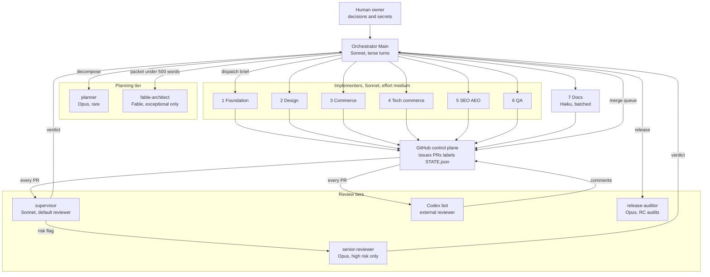

Tier share target from `model-routing-cost.md`: Sonnet about 90 to 95 percent, Haiku 3 to 7 percent, Opus plus Fable combined 2 to 5 percent.

## b. End-to-end issue lifecycle

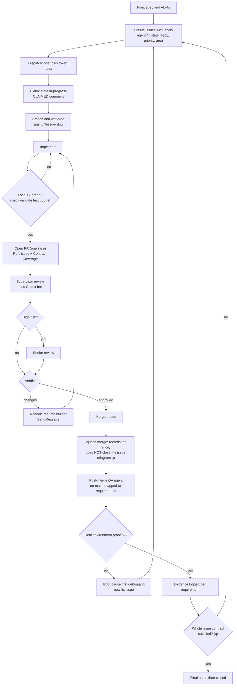

## c. PR review sequence

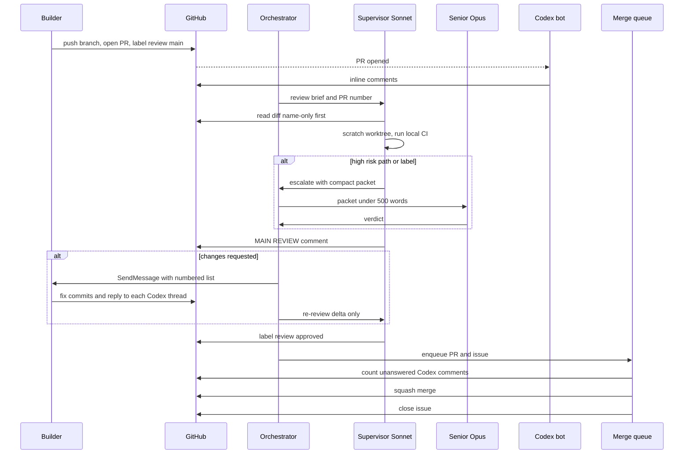

## d. Issue and PR label state machines

Observed in Nexus: `state:*` on issues and `review:*` on PRs.

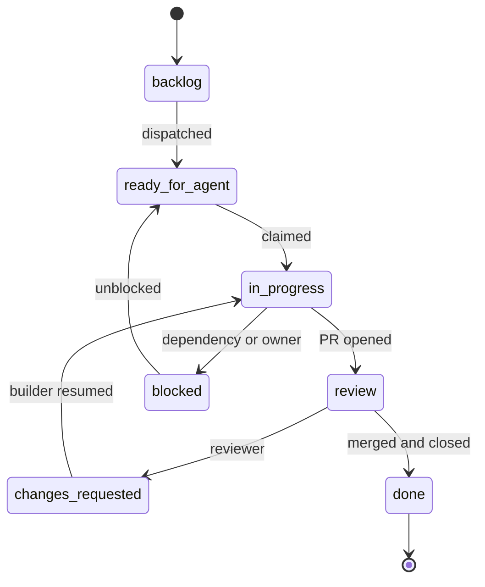

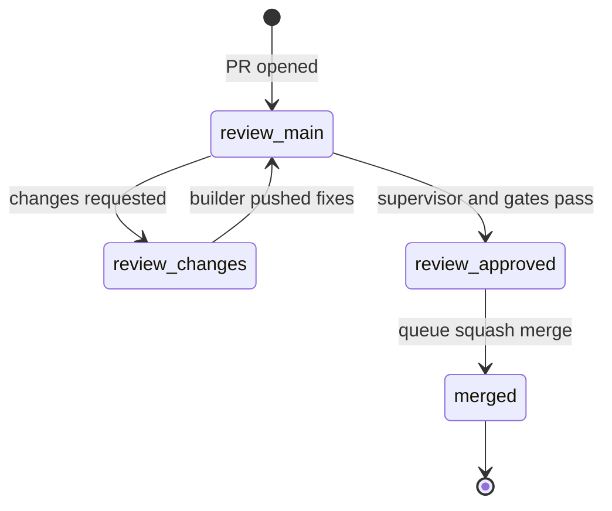

## e. Merge queue and conflict resolution

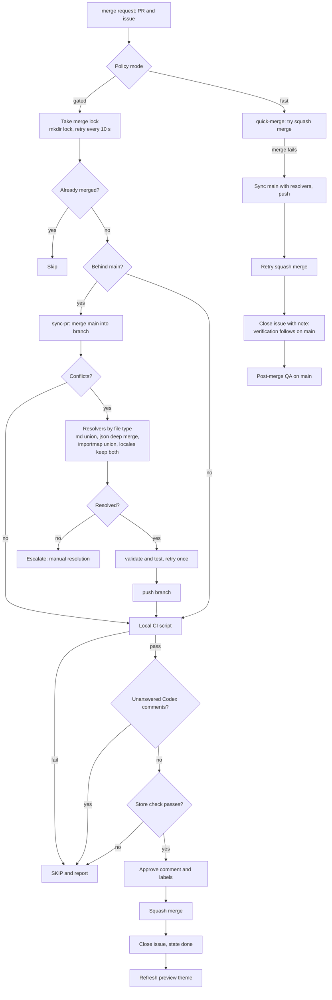

## f. Failure recovery

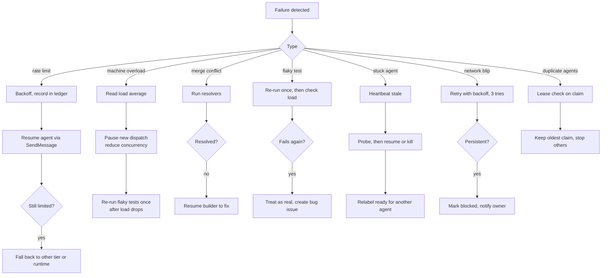

## g. Owner decisions and security gates

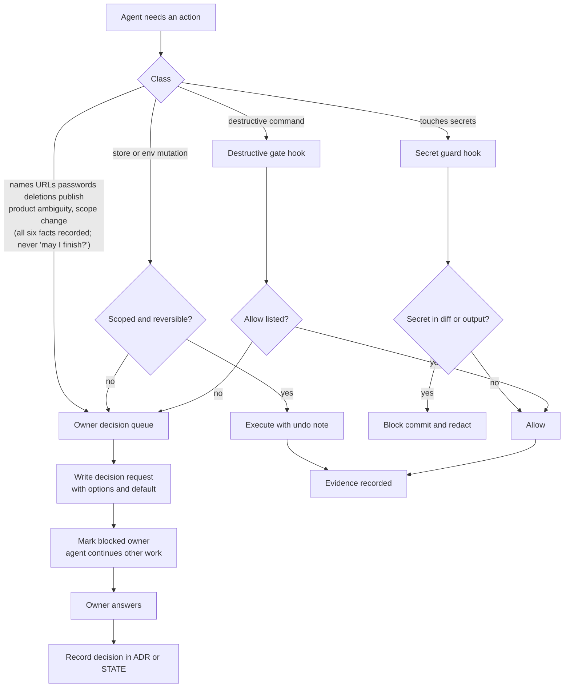

## h. Plugin component diagram

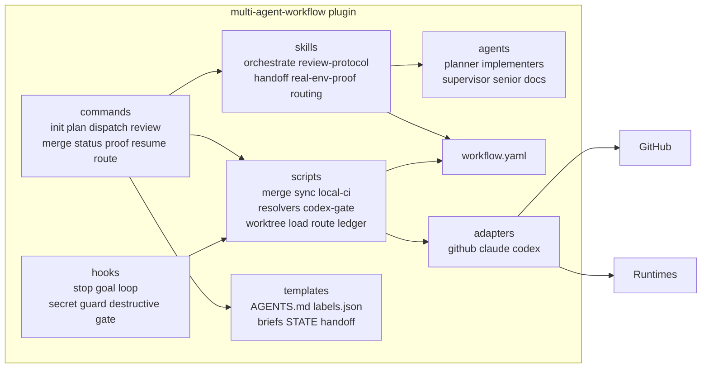

## i. Build timeline

Dates are from `git log` on the Nexus repo: 72 commits on 2026-10-18, 159 on 2026-10-19, 10 on 2026-10-20 at snapshot. Milestone names are the real GitHub milestones (M1 12 issues, M2 31, M3 20, M4 49, M5 19 at snapshot). Calendar days are compressed; the sprint was planned as "5 Day Sprint".

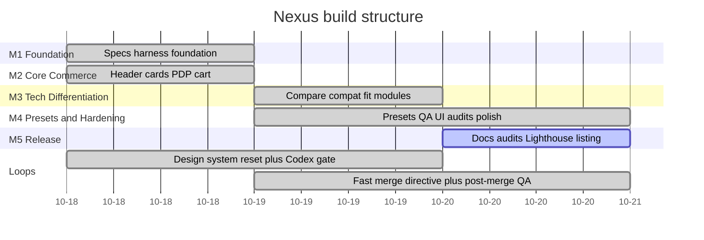

## j. Multi-runtime topology

NEW design, generalising the Nexus use of Claude Code subagents plus the Codex GitHub bot.

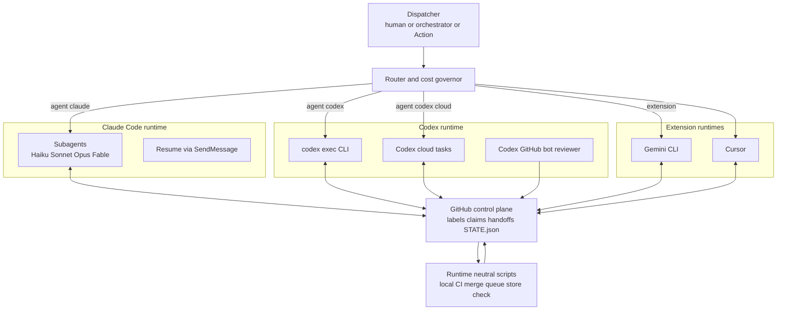

## k. Claude to Codex to Claude handoff sequence

NEW design. Review always crosses runtimes.

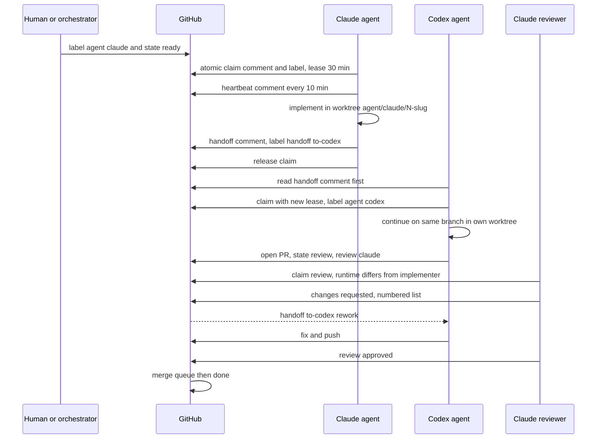

## l. Cross-agent label state machine

NEW design. `handoff:*` labels are transient and removed when the receiver claims.

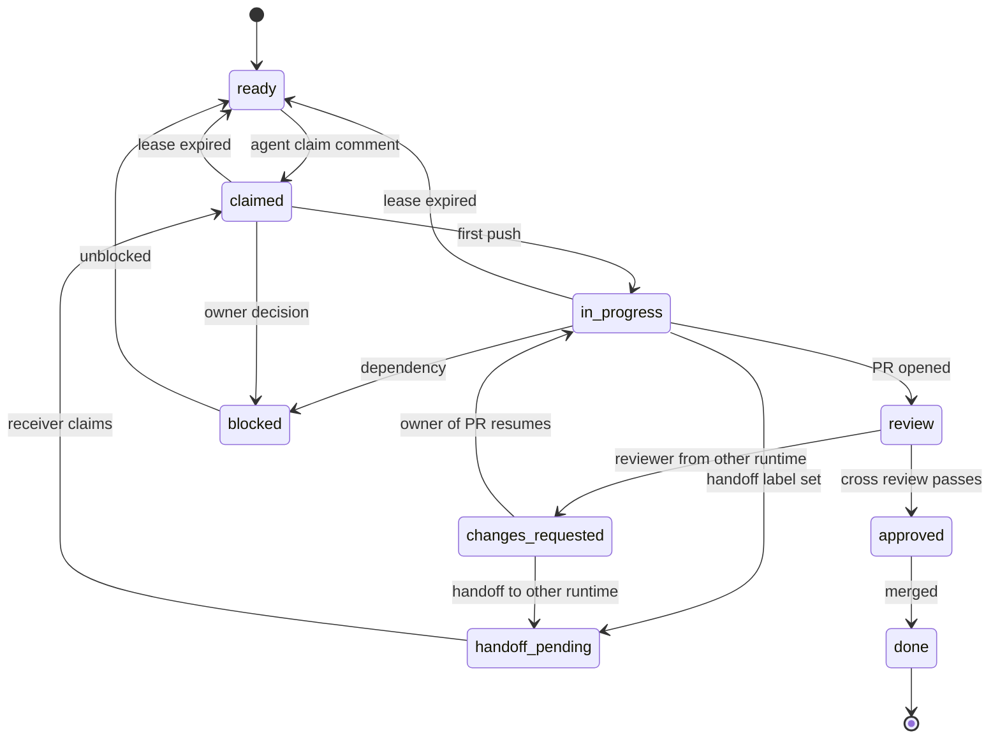

## m. Model routing decision flow

NEW automated design. In Nexus this logic lived in the orchestrator's head and in a memory note (`model-routing-cost.md`).

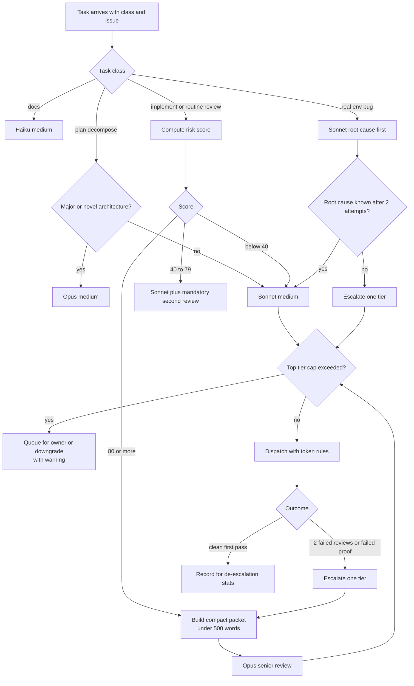

## n. Cost governor flow

NEW design.

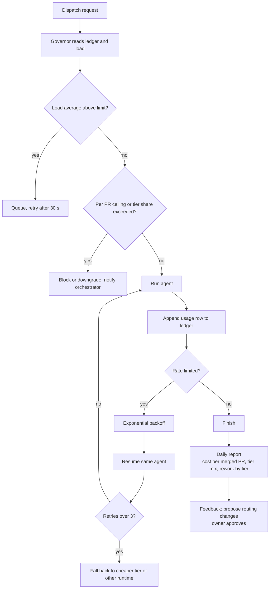

## o. Install and distribution pipeline

NEW design. One canonical source; every per-runtime package is generated, never hand-maintained.

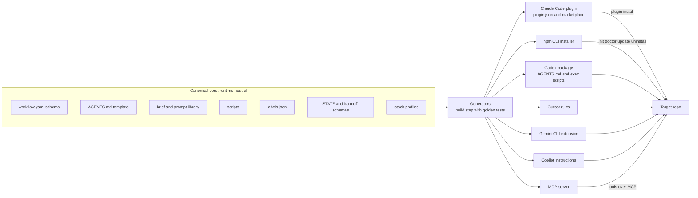

## p. Runtime-neutral MCP tool architecture

NEW design. Any MCP-capable agent can participate without runtime-specific code.

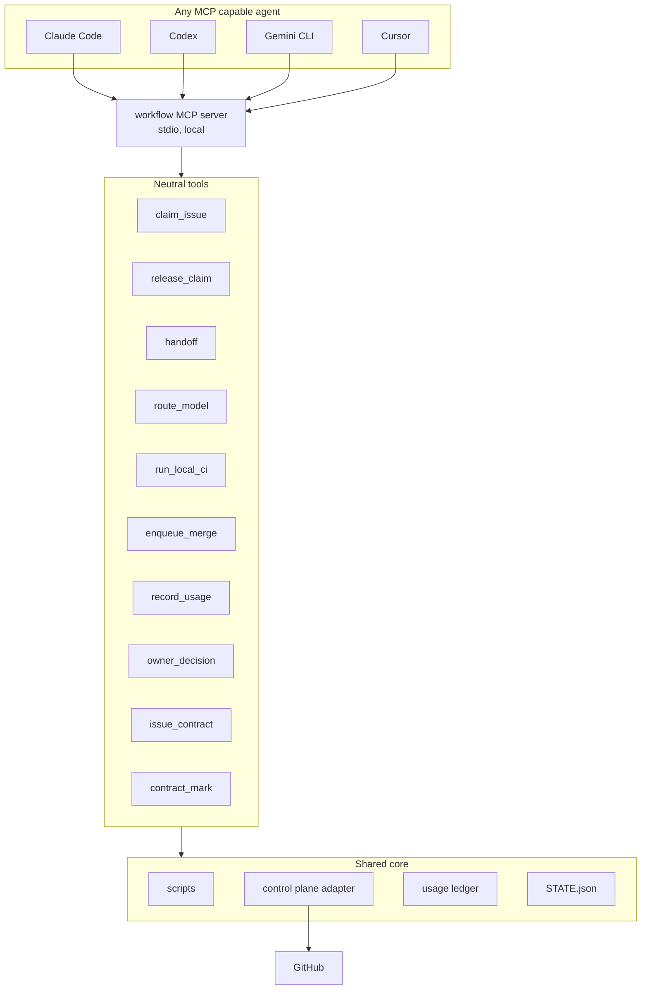

## q. Issue contract: complete issue ownership

PR complete != issue complete. Merged != verified. GitHub closed != contract complete.

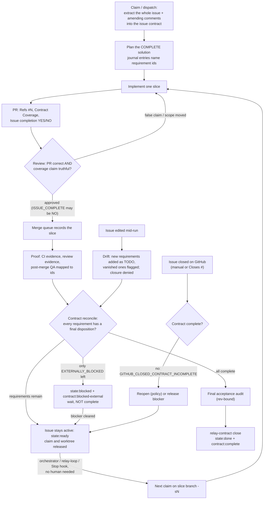
